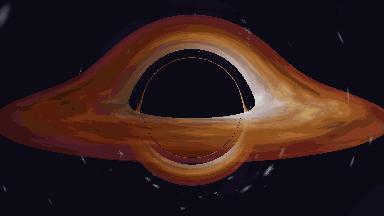
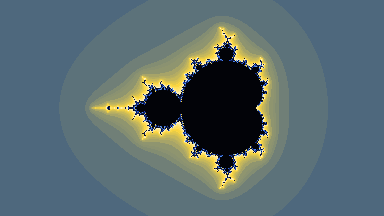
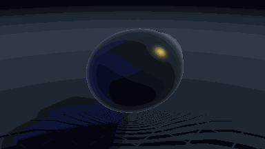
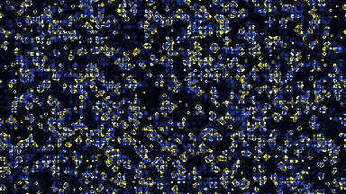

# Miri: GPU-first programming language

<p align="center">
  
</p>

**Miri is a statically typed, natively compiled programming language with first-class GPU programming: mark data `gpu`, launch with `forall`, no CUDA toolchain.**

Miri is built for **agentic engineering** — a world in which the majority of production code is generated, repaired, and shipped by autonomous agents. Humans declare intent. The compiler enforces the invariants agents are most likely to violate, and the toolchain emits structured artifacts agents can consume directly.

## GPU, from the language up

Every animation below is a real Miri program — plain `forall` loops over `gpu`-resident buffers, compiled to WGSL and run on the GPU. No host/device boilerplate.

<p align="center">
  <a href="https://miri-lang.org/gpu-demos/"></a>
  <a href="https://miri-lang.org/gpu-demos/"></a>
  <a href="https://miri-lang.org/gpu-demos/"></a>
  <a href="https://miri-lang.org/gpu-demos/"></a>
</p>

<p align="center"><b><a href="https://miri-lang.org/gpu-demos/">▶ Run all eight demos live in your browser →</a></b></p>

```miri
gpu let a = [1.0, 2.0, 3.0, 4.0]
gpu let b = [5.0, 6.0, 7.0, 8.0]
gpu var dst = [0.0, 0.0, 0.0, 0.0]

forall i in 0..a.length()
    dst[i] = a[i] + b[i]

let host = dst // the only boundary crossing: assignment = readback
println(f"{host[0]} {host[1]} {host[2]} {host[3]}") // 6.0 8.0 10.0 12.0
```

## Current State (v0.7.0-beta.5)

This release is the **Agent Contract**. Every diagnostic now carries a stable code, every subcommand can answer in a versioned JSON envelope, and a tool — CI, an editor, or a code-generation agent — can locate a problem, read its explanation, and apply the compiler's own repair without scraping human-readable text.

**New in v0.7.0-beta.5:**
- **Stable diagnostic codes** — every error and warning has a `MER_*` code from one registry (duplicate codes fail the build), and each code has a page under `docs/diagnostics/`. `miri explain CODE` prints it; `miri explain --list --format json` lists the registry.
- **JSON everywhere** — `check`, `build`, `run`, `test`, `fix`, `view` and `patch` accept `--format json` and emit a `schemaVersion: 1` envelope, documented in `docs/diagnostics-schema.json`. Warnings never flip `ok`. `miri dev --format json` streams JSONL as the file changes.
- **Repairs the compiler can apply** — a diagnostic that knows its fix carries the edit in the envelope, and `miri fix FILE --apply --yes` applies it: removing an unused import, turning a `let` into a `var` when it is written through, casting a number to the width of the place it is stored, moving statements written beside `main` into it, and more. Risky repairs need `--allow-risky`.
- **Scoped reads and checked edits** — `miri view` reads one function (`--fn`), an outline, or the public surface of a type (`--type NAME --public`) without loading the whole file. `miri patch` applies anchored edits (`--replace-in-fn`, `--replace-fn`, `--insert-fn`, `--expect-sha`) and re-checks the file in the same step.
- **`miri agent`** — the same surface over JSON-RPC on stdin/stdout, with cancellation, for harnesses that keep the compiler running.
- **Skill packs** — `miri-lang`, `miri-gpu` and `miri-testing` ship inside the compiler (`miri skill install --agent claude`); every code block in them is compiled in CI, and the [Miri for agents](https://miri-lang.org/docs/agents/) guide on the website is generated from this repository behind a drift gate.
- **Reproducible and specified** — `miri determinism check` proves byte-identical builds and runs in CI; the grammar is published as `docs/grammar.peg` with a round-trip gate; `miri fmt` rewrites a file to its canonical form.
- **Stricter, safer semantics** *(breaking)* — integer overflow, `MIN / -1` and `MIN % -1` stop the program instead of wrapping, on the CPU and inside GPU kernels; `substring` counts characters and a range outside the text is an error; mixed number types combine by value and a store never narrows; structs hold data only (no traits, no drop hook — use a class); a type that writes its own `equals` must write a matching `hash`. `check` now lowers the program as `build` does, so the two refuse the same programs.
- **Hundreds of fixes** — generic instantiation, element ABI, key identity, drop and release paths, and operator dispatch were each rebuilt around one authority and pinned by a conformance matrix, which removed the silent wrong answers and double releases that agents hit in real programs.

Building on prior betas: the Extended Standard Library (`system.fs`, `system.os`, `system.time`, regex, `system.json`, `Queue`/`Stack`, `miri test`, the heap guard), the GPU preview (WGSL backend, `gpu` residency, `forall`, kernels, vectors, eight browser demos), full Perceus memory safety, `Result<T, E>` with enforced `must_use`, a backend-agnostic `system.math`, the four-trait collection pipeline, and `system.testing`.

**Why WGSL first — and what's next.** WGSL/WebGPU is the *first* GPU backend, not the only planned one. It shipped first because it's portable and runs everywhere — including the browser, so the demos above need zero install — and it let us prove the whole language→GPU path (residency, `forall`, kernels, codegen, host runtime) end-to-end against a single target before multiplying backends. The GPU representation in MIR is being made backend-neutral so additional backends — a native SPIR-V / Vulkan path and others — can plug in behind the exact same `forall` / `gpu fn` surface, with no changes to your source.

## Language at a glance

```miri
use system.io

struct Point
    x int
    y int

fn main()
    let p = Point(x: 1, y: 2)
    println(f"{p.x}, {p.y}")
```

Value semantics are enforced — assignment is a logical copy, mutation never aliases, and memory is managed with zero annotations (only `out` for in-place mutation):

```miri
use system.collections.list

fn main()
    let a = List([1, 2, 3])
    var b = a            // copy-on-write share
    b.push(4)            // CoW fires: b becomes independent
    println(f"{a.length()} {b.length()}")   // 3 4
```

Resource types (those defining `fn drop(self)`) are tracked strictly — using one after it is consumed is a compile error, with a multi-hop diagnostic explaining *why*:

```miri
fn main()
    let f = File(handle: 1)
    archive(f)
    archive(f)           // compile error: 'f' was consumed by 'archive'
```

Miri also ships classes with inheritance and virtual dispatch, traits with default methods, closures, generics with monomorphization, pattern matching, `Option`/`Result`, tuples, enums with data, and a multi-file module system with cross-module visibility.

**→ Full language tour, GPU guide, and API docs at [miri-lang.org](https://miri-lang.org).**

## Architecture

Miri follows a standard compiler pipeline:

```text
Source(s) → Lexer → Parser → AST → Type Checker → MIR → Codegen → Executable
                                                    │
                                                    ├─ Cranelift  → native binary
                                                    └─ WGSL       → WebGPU
```

The `Pipeline` struct in `src/pipeline.rs` orchestrates discovery, frontend (lex/parse), analysis (type checking + cross-module visibility), MIR lowering with optimization passes (including the Perceus reference-counting transform), and backend codegen. On the CPU side, Cranelift is the default backend and an LLVM backend is planned for optimized production builds. On the GPU side, WGSL is the current backend; the MIR GPU representation is being made backend-neutral so native paths (SPIR-V / Vulkan and beyond) can be added behind the same surface.

## Repository Layout

```bash
src/
├── ast/          # Syntax tree definitions
├── cli/          # Command-line interface
├── codegen/      # Backend implementations (Cranelift, WGSL)
├── error/        # Error types and formatting
├── lexer/        # Source tokenization
├── mir/          # IR definitions, lowering, and optimization passes
├── parser/       # Parsing logic
├── runtime/      # Runtime intrinsics (core + GPU) — separate staticlib crates
├── stdlib/       # Standard Library (system.*), written in Miri
├── type_checker/ # Type inference, validation, residency analysis
└── pipeline.rs   # Main compiler driver
```

## Building & Testing

Miri is written in Rust. Build with a stable Rust toolchain:

```bash
make build        # Build compiler + all runtime crates (debug)
make release      # Build compiler + all runtime crates (release) → target/release/miri
make test         # Run the full suite (compiler, stdlib, runtimes)
make lint         # Check formatting + clippy
make format       # Auto-format all code
```

The compiler emits unoptimized code unless asked otherwise. `miri build --release` and `miri run --release` optimize (they mean `--opt-level 3`); `--opt-level 0`–`3` picks a level explicitly and wins over `--release`. Level 0 does not optimize, and 1–3 run the backend's speed optimizations. Time a program only from an optimized build. `--release` also leaves the runtime checks out of the code it emits: the heap guard (`MIRI_HEAP_GUARD=1`), the leak check (`MIRI_LEAK_CHECK=1`) and the allocation and reference-count counters. A release program started with one of them asked for runs unchecked and says so on stderr; to run the checks on optimized code, build with `--opt-level 3` and without `--release`.

To profile a program, build it with `--profile`: it builds what `--release` builds and keeps a frame pointer in every function, leaf functions included, so a profiler that walks frame pointers sees every caller. It links copies of the runtimes built with frame pointers, which `make build` builds into each runtime's `target/frame-pointers` beside the standard one; every other build links the standard runtimes, so `--profile` changes nothing about what `--release` measures. Where `MIRI_RUNTIME_DIR` names the runtime libraries, as in an installed toolchain, the copies belong in its `frame-pointers` directory. Without a copy a profile build stops and says where it belongs and that `make runtimes` builds it. On macOS, run the program and sample it with `sample <pid>`; on Linux, record it with `perf record --call-graph fp ./program` and read it with `perf report`. Miri functions appear under their link names: `miri.<function>` for the program's own functions, and `miri$<module path>.<function>` for those of an imported module, the standard library's included. A profile build also writes `<executable>.lines`, which `--emit lines` writes for any build: for every function, the source line each run of its machine code came from, with files named relative to the program or the standard library rather than by where they sit on the building machine. Recording it changes none of the machine code.

## Writing Miri with an AI Agent

Miri ships with a skill pack for code-generation agents — Claude Code, Cursor, and other integrations. Each skill is a compile-checked teaching guide that prevents hallucination through anti-hallucination blocks:

### Three Skills at Launch

- **miri-lang** — Core language syntax: variables, functions, structs, enums, classes, generics, pattern matching, and the two-tier prelude. Covers syntax that *does not* exist to prevent generating invalid code.
- **miri-gpu** — GPU programming: `forall` loops, `gpu fn` kernels, device memory residency, kernel context fields, and `gpu frame` rendering blocks.
- **miri-testing** — Testing workflow: the `miri test` runner, `@test` attributes, assertion functions, and test discovery.

### Install for Your Agent

The compiler bundles skills that match its version, so you never use outdated documentation:

```bash
# From the installed compiler (recommended)
miri skill install --agent claude

# Via the skills package manager
npx skills add miri-lang/miri

# Manual copy from the repository
cp skills/miri-{lang,gpu,testing}/SKILL.md ~/.claude/skills/
```

Every code block in each skill is compiled and verified by the `make skills-check` gate in CI. Agents following the taught patterns are guaranteed to generate syntax the compiler accepts.

## Contributing

We welcome contributions! Please read our [Contributing Guide](CONTRIBUTING.md) for details on code style, testing requirements, and the submission process.

### Contributors

- Viacheslav Shynkarenko aka Slavik Shynkarenko (maintainer)

## License

[Apache-2.0](LICENSE)
